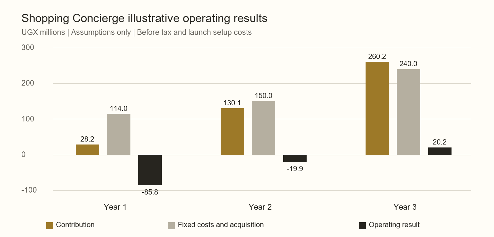

# Peebee Shopping Concierge Business Plan

Investor and funding proposal draft | Uganda | Kampala and Entebbe | 10 November 2026

## Executive summary

Peebee Shopping Concierge enables a customer to submit a shopping list and have one rider accept the assignment, purchase the goods and deliver them. The proposed launch covers selected service areas within Kampala and Entebbe. Peebee is pre-launch and has no paying customers, as confirmed by the founder. Its existing software supplies the foundation for a commercial pilot; commercial demand and operating performance remain to be demonstrated.

The investment proposition is to establish a dependable shopping service that customers use repeatedly and that pays riders enough to sustain reliable supply. Peebee would coordinate lists, rider selection, payments, substitution approvals, delivery tracking and settlement. It would initially earn a customer service fee and a share of the shopping and delivery charge. No merchant commissions, advertising income or revenue from other Peebee businesses are assumed in this plan.

This draft proposes an illustrative **UGX 160 million funding envelope for an 18 month pilot and early growth period**, subject to founder review, supplier quotations and confirmation of the lawful payment arrangement. The base scenario models 10,400 completed orders in year one, 48,000 in year two and 96,000 in year three. It produces operating losses of UGX 85.8 million and UGX 19.9 million in the first two years, followed by an operating surplus of UGX 20.2 million in year three, before tax and the separate launch setup cost. These are planning assumptions, not forecasts supported by trading history.

Three findings determine the investment decision. First, payment collection on the entire shopping basket can consume a substantial part of Peebee's fee income. Second, customer prepayment does not automatically fund the rider's purchases in the standard settlement flow. Third, the proposed pricing would leave cash-order riders with much lower earnings under the current deduction logic. The recommended commercial pilot therefore concentrates on prepaid orders, affordable purchasing liquidity and measured repeat demand before wider expansion.

## Business scope and customer problem

The initial service is shopping from local retailers and markets for delivery to homes or small workplaces. A single rider handles purchasing and delivery. Peebee does not need to own goods, lease a warehouse or buy motorcycles for the base operating model. This reduces inventory and fleet investment but creates a dependence on reliable independent riders, accurate shopping and sufficient purchasing liquidity.

The customer hypothesis is that some households and small offices will pay a disclosed fee to avoid the travel, shopping and coordination involved in replenishing everyday supplies. Peebee must validate the size and frequency of that need through paid orders. National connectivity and population figures establish context; they do not establish willingness to pay.

The first commercial focus should be households with recurring grocery and household-essential purchases in compact service areas. Small offices are a secondary segment for scheduled replenishment. Purchases for relatives are a further hypothesis once payer and recipient handling has been verified. The base forecast does not assume signed corporate accounts, diaspora customers or existing partnerships.

Prescription medicines, prepared food delivery, wholesale procurement, fuel and the wider Peebee marketplace have separate economics and are outside this plan. Bulky, hazardous, age-restricted and cold-chain goods should be excluded from the proposed initial service until handling requirements and economics are established. These are proposed launch policies, not claims about current application enforcement.

## Existing product and commercial readiness

The repository reviewed at commit `4871a68f9e475728c7e45624d817a7f06968d671` contains the following relevant capabilities. Repository evidence confirms implementation; it does not establish that integrations, licences, migrations or live settings are operational.

| Capability | Evidence and business implication |
| --- | --- |
| Shopping lists and rider assignment | Shopping orders, rider claim and application flows, and matching are implemented. Local rider availability remains an operating requirement. |
| Customer payment | Funding supports mobile money, card, wallet and cash paths. Real provider credentials, contracts and successful live transactions must be verified. |
| Substitution approval | Riders can propose individual or grouped changes for customer decisions. Approved changes can affect the agreed total. |
| Delivery and completion | Location updates, delivery stages, a customer handover PIN and rider settlement exist. These support accountability but do not prove service quality. |
| Monetisation | Admin settings govern service fees, delivery commissions and processing charges. Money flow can add further commission; the model assumes that extra commission is zero. |
| Direct merchant funding | Shopping-principal budgets and merchant allocations exist, with live activation and current custody-approval checks. Code defaults leave live merchant funding off. |

The stored default shopping delivery charge is UGX 3,000. The financial model deliberately tests a higher proposed charge of UGX 6,000 and states the change as a commercial assumption. Default service and delivery commission switches do not establish a commercially active fee policy. Live values were not inspected or changed.

The plan does not rely on camera search, paid shopping membership or other promotional features whose activation and backend readiness have not been established.

## Customer experience and money movement

The intended journey follows the existing order flow: the customer creates a list; a rider is assigned; the customer funds a prepaid order; the rider shops and seeks approval for changes; the rider delivers; the handover PIN confirms receipt; settlement follows. The experience must clearly separate the estimated goods budget from Peebee's fees and the rider's shopping and delivery charge.

There are three materially different financial paths:

1. **Standard prepaid order.** Peebee collects the customer payment. In the legacy flow, the rider receives the collected amount less applicable fees after handover and settlement. That payout includes reimbursement of goods purchased. The code reviewed does not establish an unrestricted cash advance to the rider at shopping time. A rider may therefore need purchasing funds even though the customer has prepaid.
2. **Merchant allocation order.** Where the merchant-payment feature and custody approval are active, the platform separates shopping principal from the settlement pool and allocates principal for merchant purchases. This can reduce rider purchasing-fund needs at participating outlets. It is conditional on the relevant controls and agreements; it is not assumed live throughout the launch market.
3. **Cash order.** The rider fronts purchases and collects from the customer on delivery. Platform fees are recovered from the rider wallet at settlement. Collection risk, fee recovery and rider liquidity differ from prepaid orders.

There is also a price-change limitation: an approved substitution or fee increase after initial collection does not itself establish that additional funds were collected. Settlement caps release at the amount actually received. Operations must resolve any shortfall before additional purchasing, using supported payment procedures and a documented exception process. This plan does not promise automatic top-ups or universal automatic refunds.

For the pilot, use prepaid orders as the financial-model scope. Confirm how that service policy is enforced in the actual launch configuration. Where riders advance funds, explain reimbursement timing and measure settlement and withdrawal delays. Where direct merchant payments are used, verify the complete approved payment chain before transacting.

## Uganda market and launch geography

Uganda Bureau of Statistics reports **1,797,722 people and 529,057 households in Kampala Capital City** in its 2024 census profile. These are city-boundary counts, not Greater Kampala or Kampala plus Entebbe totals. They provide an authoritative starting population frame. [UBOS Kampala census profile](https://www.ubos.org/wp-content/uploads/2025/06/Kampala-Capital-City-Census-2024-Profile-Report.pdf)

The government's Greater Kampala programme covers a broader area that includes Entebbe, Wakiso, Mukono and Mpigi. Its published overview quotes a preliminary 2024 regional population estimate of 6.2 million. That broader estimate is not used as Peebee's launch customer denominator, and Entebbe is not added again to that regional figure. [Greater Kampala programme overview](https://gkma.op.go.ug/gkma-udp/overview)

UCC reported 36.3 million active mobile money accounts and 18.5 million internet subscriptions as of December 2025 in a May 2026 publication. These national accounts and subscriptions are not unique people or shopping customers. They support the choice to test mobile-enabled ordering and payment, without quantifying Peebee's demand. This is dated context, not a claim to be the latest quarterly measurement. [UCC digital access update](https://www.ucc.co.ug/uganda-communications-commission-a-snapshot-of-gains-impact-and-progress/)

Kampala and Entebbe should operate as two local service areas with separate rider coverage and performance reporting. The initial promise should be shopping and delivery within each area. Routine cross-city shopping at a single flat fee is excluded from the base economics. Specific neighbourhoods and operating hours should follow rider availability, outlet access and measured travel times, with any applicable platform policies controlled through Admin.

## Market sizing and attainable demand

There is not yet enough evidence for an investor-grade national shopping-concierge TAM in revenue terms. The census household count is a population frame, not a proven paid market. This plan instead provides transparent bottom-up opportunity scenarios and an operating-volume target.

The serviceable-market scenarios below assume a reachable pool of households or small-office accounts across Kampala and Entebbe. Each account is counted once; customer segments are not added together. The pool sizes and order frequencies are judgement assumptions requiring field validation. All three scenarios retain an assumed UGX 60,000 goods basket and UGX 3,500 core Peebee fee revenue per order.

| Opportunity scenario | Reachable accounts assumed | Orders per account per month assumed | Annual orders at full pool adoption | Annual goods purchase value | Annual core Peebee revenue pool |
| --- | ---: | ---: | ---: | ---: | ---: |
| Low | 10,000 | 1 | 120,000 | UGX 7.2bn | UGX 420m |
| Base | 20,000 | 2 | 480,000 | UGX 28.8bn | UGX 1.68bn |
| High | 30,000 | 3 | 1,080,000 | UGX 64.8bn | UGX 3.78bn |

Formula: reachable accounts × monthly frequency × 12 × basket or core fee. These are alternative opportunity scenarios, not additive markets or expected sales. They assume every account in the selected pool adopts at the stated frequency. The base opportunity pool is not an independently measured SAM.

The year-one operating target of 10,400 orders is much smaller and is built from a monthly ramp. The proposed month-twelve target of 2,100 orders would require about 1,050 monthly active accounts if each ordered twice. By year three, an average 8,000 orders per month would require approximately 4,000 monthly active accounts at the same frequency. Customer counts are derived requirements, not existing demand or registrations.

## Competition and differentiation

Glovo's current Kampala page lists groceries, shops and other delivery categories, establishing a direct digital alternative. Delivery availability and charges depend on the address and were not tested through checkout. Peebee must win customers in an already served category. [Glovo Kampala](https://glovoapp.com/en/ug/kampala)

Other relevant alternatives are retailer-arranged delivery, a customer arranging purchases with a familiar boda rider, and shopping personally. Their local availability, charges and service reliability need direct comparison during the pilot. This draft does not assign them market shares or claim Peebee is cheaper or faster.

Peebee's proposed positioning is a personal shopping service built around the customer's list, with explicit approval of substitutions and traceable completion. Its potential advantage is dependable handling of less standardised shopping needs. This is a value proposition to test, not a defensible moat already established by software. Local rider quality, customer trust, repeat purchasing and reliable retail relationships would need to become the stronger competitive assets.

Validate the proposition through comparable paid shopping tasks in each launch area. Record total customer cost, item availability, approval handling, elapsed time and complaint resolution. No competitor purchases or outreach have been undertaken for this draft.

## Revenue model and proposed launch pricing

The base model uses the existing flat shopping delivery setting, flat customer service fee, shopping delivery commission and customer processing fee. All amounts below are proposed test assumptions. They are not live settings, negotiated provider tariffs or commitments to customers.

| Pricing input | Base assumption | Treatment |
| --- | ---: | --- |
| Goods basket | UGX 60,000 | Pass-through purchase value; not Peebee revenue |
| Shopping and delivery charge | UGX 6,000 | Rider compensation pool before commission |
| Customer service fee | UGX 2,000 | Core Peebee fee income |
| Commission on delivery charge | 25% or UGX 1,500 | Core Peebee fee income; not a percentage of the goods |
| Customer processing charge | 2% of goods plus delivery, rounded | UGX 1,500 under default UGX 500 fee rounding |
| Extra Money flow commission | Zero | Avoid double charging the rider in this model |
| Discounts and subscriptions | No recurring subsidy or subscription income | Acquisition promotions must fit the separate acquisition budget |

The customer pays UGX 69,500: goods 60,000 + delivery 6,000 + service 2,000 + processing 1,500. Peebee receives UGX 3,500 in core fees and UGX 1,500 processing recovery. The remaining UGX 64,500 ultimately reimburses the goods and gives the rider UGX 4,500 before their operating expenses.

The goods basket is not sales revenue earned by Peebee. The full delivery charge is also not retained revenue. The presentation of processing recovery as gross or net accounting revenue must be agreed with the accountant; the management model shows it separately and deducts actual provider costs. Customer funds and rider reimbursements cannot fund Peebee's operating expenditure.

## Unit economics and rider viability

| Per completed prepaid order | Base UGX |
| --- | ---: |
| Core fee revenue | 3,500 |
| Processing recovery | 1,500 |
| Total platform fee receipts | 5,000 |
| Assumed all-in payment cost at 2% of customer collection | (1,390) |
| Variable customer support allowance | (500) |
| Expected loss and refund-cost allowance | (300) |
| Variable communications allowance | (100) |
| Contribution before fixed costs and acquisition spending | **2,710** |

The all-in payment-cost allowance must cover collection and allocated disbursement costs; it is not a provider quote. Refund loss allowance represents Peebee's expected cost, not all principal returned to customers. Fixed support staff costs cover staffing availability; the per-order allowance covers incremental handling and overflow. Both require measured validation to avoid double counting.

The customer pays UGX 9,500 above the goods value, equivalent to about 15.8% of the assumed basket. The service must create enough convenience and trust to justify that price. The rider's UGX 4,500 is gross compensation before fuel, maintenance, data, purchasing time and idle time. At four completed shopping orders per day over 26 days, it is UGX 468,000 monthly before these expenses. At a 60 to 90 minute task duration, gross compensation would be approximately UGX 3,000 to 4,500 per active hour. These are calculations, not evidence that the pay is acceptable.

In the standard prepaid flow, one UGX 60,000 basket can also tie up roughly UGX 60,000 of rider purchasing money until payout is usable. One hundred simultaneous such purchases could require UGX 6 million across riders. At the year-three base volume, roughly 77 riders completing four orders per day would provide average daily capacity, before absence and peak-demand cover. Recruiting riders without solving earnings and liquidity would not establish usable capacity.

**Cash-order sensitivity is material.** With the same assumed settings, the cash handler works from a UGX 66,000 goods-plus-delivery total and deducts service, processing and commission from the rider wallet. Platform deductions total UGX 5,000, leaving UGX 1,000 of the delivery charge to the rider before expenses. Cash is therefore excluded from base projections. The launch policy and fee disclosure need to be settled before admitting cash shopping into the commercial pilot. This plan does not assume a code fix or change those settings.

## Financial scenarios and break even

Years are measured from commercial launch; no launch date is assumed. Values below are UGX millions, except orders. Commercial inputs are judgement assumptions in nominal UGX. The model holds base per-order economics constant to expose the volume required; it does not assume inflation has no effect.

| Measure | Year one | Year two | Year three |
| --- | ---: | ---: | ---: |
| Completed orders | 10,400 | 48,000 | 96,000 |
| Goods purchase value | 624.0 | 2,880.0 | 5,760.0 |
| Customer payments including all fees | 722.8 | 3,336.0 | 6,672.0 |
| Core Peebee fee revenue | 36.4 | 168.0 | 336.0 |
| Processing recovery | 15.6 | 72.0 | 144.0 |
| Total platform fee receipts | 52.0 | 240.0 | 480.0 |
| Contribution after variable costs | 28.2 | 130.1 | 260.2 |
| Fixed operating costs including shared services | (96.0) | (120.0) | (192.0) |
| Customer acquisition spending | (18.0) | (30.0) | (48.0) |
| Operating result before tax and launch setup | **(85.8)** | **(19.9)** | **20.2** |

At the year-one cost base, including acquisition spending, break even requires approximately 3,506 completed orders per month. At the year-three cost base it requires approximately 7,381, against an assumed monthly average of 8,000. The resulting margin for cost overruns is thin. Year-three positive operating results are not recovery of the accumulated investment or a guaranteed investor return.

The model is before income tax, financing costs, depreciation and amortisation, and the separate UGX 20 million launch setup budget. It does not calculate applicable VAT, withholding or other indirect tax obligations. If proposed customer prices must absorb additional indirect taxes, contribution falls. Tax treatment must be resolved with the accountant before pricing is presented as final. The initial operating reserve is not a substitute for these decisions. Existing development expenditure, licences to use group IP and founder balances are not quantified.

### Sensitivity to basket and service costs

| Input or result | Downside | Base | Upside |
| --- | ---: | ---: | ---: |
| Average goods basket | 80,000 | 60,000 | 50,000 |
| Assumed all-in payment-cost rate | 2.5% | 2.0% | 1.5% |
| Rounded customer processing recovery | 1,500 | 1,500 | 1,000 |
| Support allowance per order | 800 | 500 | 350 |
| Loss allowance per order | 800 | 300 | 150 |
| Communications per order | 100 | 100 | 100 |
| Contribution per completed order | **1,062.50** | **2,710** | **3,015** |

These are joint stress scenarios, not statistical confidence intervals. Delivery, service and commission assumptions remain unchanged. A larger basket can lower contribution because processing recovery is rounded and the provider cost applies to the whole collection. Under the base volume and cost structure, a UGX 500 reduction in contribution would reduce year-three operating results by UGX 48 million and turn the modeled surplus into a loss.

## Customer acquisition and retention

The proposed launch should concentrate demand in compact local areas rather than promote citywide availability immediately. Recruit initial customers through residential communities, workplaces, local retail relationships and founder-led demonstrations. All are proposed channels; no access agreements or merchant endorsements are claimed.

Begin with a limited number of paid orders, track which channels produce completed purchases, and expand only where repeat use and service performance hold. Discounts must be explicit acquisition expenditure. Free and heavily subsidised orders must be reported separately from full-price demand.

The year-one acquisition budget is UGX 18 million. A proposed paid customer acquisition ceiling of UGX 15,000 would buy about 1,200 first-time paying customers if achieved. Organic acquisition is an additional hypothesis, not assumed proof of demand. At two orders per month and base contribution, a customer contributes UGX 5,420 monthly before acquisition and fixed costs; a UGX 15,000 acquisition cost takes about 2.8 active months to recover. At one order monthly, payback rises to about 5.5 months. No lifetime value claim is justified before retention is measured.

Record customers by first paid-order month, channel and launch area. Measure the share that completes another paid order within 30 days, with a full 30-day observation window. Distinguish registrations, first-time paying customers and active repeat customers. The operating ramp must be revised if acquisition and repeat-order evidence do not support it.

## Operations and staffing

Launch with nominated operating leads for Kampala and Entebbe coverage, supported by shared dispatch and customer care. Riders use their own motorcycles and smartphones under an agreed engagement model. Before onboarding, confirm identity, lawful riding documentation, vehicle suitability, purchasing capacity and the process for resolving disputes. Riders need practical training in item quality, quantity checks, substitutions, evidence of purchases and customer handover.

Use the first orders to map task duration and costs by local area, basket size and outlet type. Do not promise a universal delivery time before observing actual shopping and travel times. Retail relationships should improve product availability and evidence of purchase; the financial plan does not rely on negotiated product discounts.

The proposed year-one fixed operating budget is UGX 8 million monthly:

| Cost allowance | Monthly UGX |
| --- | ---: |
| Operations lead | 2,000,000 |
| Dispatch and customer care staffing | 2,000,000 |
| Field onboarding and service quality | 1,500,000 |
| Bookkeeping and routine professional support | 500,000 |
| Allocated technology maintenance and shared platform services | 1,500,000 |
| Facilities and administration | 500,000 |
| Total | **8,000,000** |

These are budget allowances, not salary or supplier quotations. Employer obligations and insurance must fit the validated budget or increase it. Growth allowances rise to UGX 10 million monthly in year two and UGX 16 million in year three. Rider reimbursements and gross delivery earnings are not salaried staffing costs and are reconciled through each order.

Shared software, support tools, payment administration and management resources must be allocated to Shopping Concierge consistently. The plan includes an initial allocation but does not assume free unlimited engineering or cross-subsidy from other Peebee businesses. Any separate investment vehicle would need documented rights to use the Peebee brand and software and a commercial shared-services agreement.

## Funding requirement and use of funds

The proposed UGX 160 million envelope is a modeled funding requirement, not a founder-approved fundraising amount. It assumes external capital is available at the start, no existing liabilities, no dividends, no inventory purchases by Peebee and no customer principal used for operations.

| Use of funds over the first 18 months | UGX million |
| --- | ---: |
| One-time launch preparation | 20.000 |
| Year-one net operating cash deficit | 85.816 |
| Months 13 to 18 net operating cash deficit | 23.781 |
| Remaining operating contingency at month 18 | 30.403 |
| Total proposed funding | **160.000** |

The UGX 20 million setup allowance comprises UGX 7 million for professional, regulatory and insurance preparation; UGX 5 million for rider training and basic shopping equipment; UGX 5 million for payment, reconciliation and reliability readiness; and UGX 3 million for launch materials and operational setup. These allowances require quotations and do not assert that all licence or insurance costs fit them.

Month-18 modeled cash remains UGX 30.4 million in the base case. This is an operating contingency. It is not customer escrow, rider purchase financing or revenue. If Peebee rather than riders must finance shopping principal, a separate approved working-capital facility and loss model are required.

With order volumes at half the base ramp and downside contribution of UGX 1,062.50, the same 18 month expense commitments require approximately UGX 193.4 million before contingency, exceeding the proposal by UGX 33.4 million. Management must slow spending and growth if performance is weak. The UGX 160 million proposal does not guarantee 18 months of runway in that case.

A proposed staged release is UGX 60 million for readiness and the initial pilot, with the remaining UGX 100 million linked to agreed service, retention and economic milestones. This is a funding structure to negotiate; no investor, instrument, valuation, equity allocation or grant eligibility is assumed. An equity case must show a credible path beyond the modest modeled year-three surplus. A grant case could emphasise measured rider earnings and access benefits, without treating expected impacts as achieved outcomes.

## Pilot milestones and management controls

| Period | Deliverable and proposed decision criteria |
| --- | --- |
| Before commercial launch | Confirm company and payment arrangements, service coverage, rider purchasing liquidity, fee disclosure, reconciliation and a successful controlled end-to-end payment and refund exercise. Do not count practice-world activity as traction. |
| Commercial months one to three | Complete the first paid pilot cohort. Use the first 500 completed paid orders as an evidence milestone; the volume ramp reaches 500 cumulatively at month three if achieved. |
| Before increasing acquisition spending | Proposed targets: at least 90% of accepted orders completed; at least 30% of eligible first-time buyers reorder within 30 days; customer acquisition cost at or below UGX 15,000; contribution at or above UGX 2,500 per order; rider earnings acceptable after measured expenses. Targets are assumptions, not industry benchmarks. |
| Months four to six | Expand local coverage only where the preceding criteria and daily money reconciliation hold. The base ramp reaches 2,000 cumulative completed orders at month six. |
| Months seven to twelve | Aim for 10,400 year-one orders and a 2,100 monthly exit rate, conditional on service capacity and retained customers. Reforecast monthly. |

Commercial launch follows required readiness; no regulatory approval duration is assumed. Any policy enforced by the product must be configured through existing Admin settings or implemented through the repository's admin-controlled settings process; this document changes no product behaviour.

Management should review completed orders, on-time delivery against the quoted window, approval delays, complaint costs, contribution, rider gross and net earnings, cash and wallet reconciliation, and customer cohorts separately for Kampala and Entebbe. Any material unexplained money difference requires prompt investigation before increasing payment exposure. Compliance and safety requirements remain obligations even if commercial targets are met.

## Regulatory and risk considerations

Peebee's legal entity, ownership, brand and software rights, tax registrations, rider contracts and actual approvals have not been supplied for this draft. They are investor diligence items, not reasons to invent company credentials.

The Bank of Uganda describes licensing and oversight of payment service providers and payment system operators under Uganda's payment framework. Peebee must obtain qualified confirmation of its role, custody arrangements and partner responsibilities before describing its wallet or code-labelled escrow as regulated or legally safeguarded. A ledger implementation is not a licence. [Bank of Uganda payment framework](https://bou.or.ug/financial_infrastructure_innovation)

UCC publishes courier licence categories and application requirements. Confirm the category and permissions applicable to the shopping-and-delivery model and the intended coverage; do not infer that an app or a rider's documentation provides the company's authorisation. [UCC postal and courier licensing](https://www.ucc.co.ug/postal-and-courier/)

PDPO publishes registration and compliance guidance for organisations handling personal data. Confirm the applicable registration, privacy notices, rider access to customer details, retention, breach procedures and obligations of service providers. [PDPO knowledge centre](https://pdpo.go.ug/knowledge-center)

| Principal risk | Business response |
| --- | --- |
| Low willingness to pay or weak repeat use | Validate full-price orders and mature repeat cohorts before geographic expansion. |
| Rider earnings or purchasing liquidity too low | Measure costs and time; validate settlement access; use only approved merchant-funding arrangements where available. |
| Payment costs absorb fees | Obtain all-in provider quotes by payment method and basket size; refresh the unit economics. |
| Cash fees reduce rider earnings or remain uncollected | Exclude cash from base pilot economics and resolve policy, disclosure and fee recovery before adding it. |
| Price changes exceed funds collected | Resolve shortfalls before further buying; reconcile agreed, collected, purchased and reimbursed amounts. |
| Wrong, damaged or missing goods | Train riders, obtain purchase evidence, use approval records and investigate claims. |
| Injury, theft or customer data misuse | Validate insurance, rider standards, lawful data handling and incident response. |
| Shared-platform costs understated | Agree cost allocation and IP access; maintain module-level management accounts. |
| Slower growth or tax obligations exceed the model | Reforecast cash monthly and reduce commitments before reserves are depleted. |

## Investor proposition and remaining diligence

The strongest present funding proposition is a disciplined commercial validation programme built on existing technology. The next value milestone is evidence that customers reorder at disclosed prices, riders can fund and perform the work sustainably, and Peebee retains a positive contribution after actual payment and service costs.

The base case does not yet establish a high-return standalone equity investment. Its year-three operating surplus is small compared with the initial capital and is sensitive to costs. Further investment should depend on measured retention, efficient acquisition and demonstrated capacity to increase profitable order density. An exit valuation or investor return would be speculative at this stage and is not presented.

Before external submission, add the founder and team biographies, legal entity and cap table, evidence of IP ownership or usage rights, actual capital already invested, provider and insurance quotations, tax treatment, relevant approvals and signed partner agreements if any. Replace the major pricing, timing, retention and cost assumptions with pilot evidence as it becomes available. These gaps do not change the confirmed launch geography or one-rider shopping model.

## Sources and model notes

Founder-confirmed facts from this planning conversation are Uganda as the market, Kampala and Entebbe first, no paying customers yet, and one rider accepting the list, purchasing and delivering. Market observations were researched on 10 November 2026. Source measurement dates are retained above; no external source supplies Peebee's forecast inputs.

Repository evidence is pinned to the reviewed commit so later code changes do not silently alter this draft's claims:

- [Shopping order flow and settlement](https://github.com/Peebee-Application/Peebee/blob/4871a68f9e475728c7e45624d817a7f06968d671/apps/api/src/orders/routes.ts) — funding, substitutions, location, handover and rail-specific settlement.
- [Fee calculations](https://github.com/Peebee-Application/Peebee/blob/4871a68f9e475728c7e45624d817a7f06968d671/apps/api/src/lib/monetization.ts) — service fees, processing recovery, delivery commission and rider payout.
- [Admin defaults and settings](https://github.com/Peebee-Application/Peebee/blob/4871a68f9e475728c7e45624d817a7f06968d671/apps/api/src/lib/settings.ts) — shopping delivery default, monetisation switches and merchant-funding defaults.
- [Merchant funding and custody gates](https://github.com/Peebee-Application/Peebee/blob/4871a68f9e475728c7e45624d817a7f06968d671/apps/api/src/merchants/service.ts) — principal budgets, activation and settlement separation.
- [Additional commission and money-flow records](https://github.com/Peebee-Application/Peebee/blob/4871a68f9e475728c7e45624d817a7f06968d671/apps/api/src/costing/splits.ts) — additional commission can affect rider earnings; assumed zero here.
- [Fee rounding](https://github.com/Peebee-Application/Peebee/blob/4871a68f9e475728c7e45624d817a7f06968d671/packages/shared/src/fare.ts) — fee calculations use `roundNearest`; verify the exported implementation against the model when fee rounding settings change.

The accompanying [model script](model.py) contains inputs, formulas and reconciliation checks. [Calculated model results](financial-model.json) include the 18 month cashflow. Run the script with the Codex bundled Python and Pillow to reproduce both the results and chart. Runtime analysis records are supporting material; the business plan is the primary deliverable.

Core formulas are: platform core revenue = service fee + delivery commission; customer collection = goods + delivery + service + processing; contribution = core revenue + processing recovery − actual payment costs − variable support − expected loss costs − communications; operating result = orders × contribution − fixed costs − acquisition expenditure. Operating break even is the next whole order above monthly fixed and acquisition costs divided by contribution.

The model assumes prepaid non-wallet orders with no discounts, no additional Money flow commission and base rounding of UGX 500. Wallet and cash mix changes require separate calculations; wallet funding costs cannot simply be treated as zero because the order itself has no external processing step. Customer money, merchant money and rider reimbursement remain separate from Peebee's operating cash. Figures may be rounded in the narrative; the model retains exact arithmetic.
